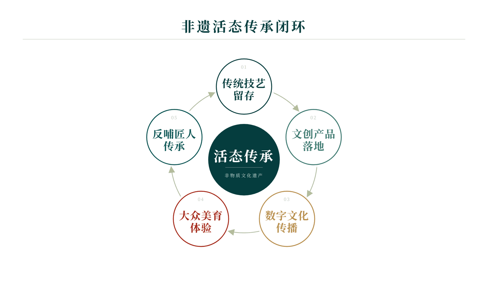
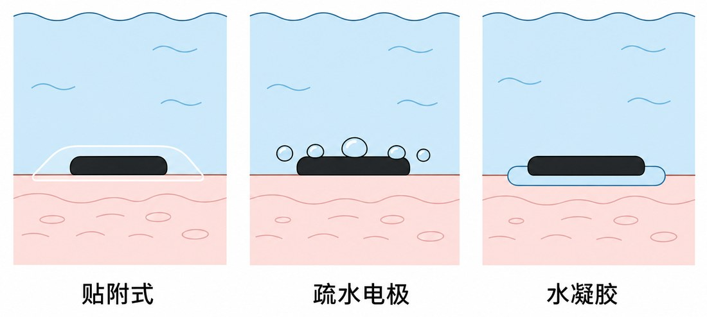

# bor-figures-style

一份判断「简约高级」的标准，给 AI 代理（Claude Code / Codex 等）用来产出克制、干净的版面。

**它不是一套配色的规定。** 用什么颜色、什么字体、什么工具，都是实现问题；这个 skill 定的是一条线——什么样的版面算「简约高级」，什么样的不算。

## 核心定义

> **简约** = 在不损失信息的前提下，删掉一切可删的。
> **高级** = 凑近看，细节都对得上。

两者独立：删得干净但细节毛糙，是廉价；细节精致但塞满，是啰嗦。

## 六条约束

| | 约束 | 一句话 |
|---|---|---|
| ① | 减法优先 | 删掉它信息会丢吗？不会就删。装饰性元素默认全删 |
| ② | 层级靠对比 | 只有字号差、字重差、颜色深浅，不用色块和卡片分区 |
| ③ | 对齐是死的 | 同类元素同字号、同位置、同间距。「差不多」就是错 |
| ④ | 留白是内容 | 宁可空着不要塞。少字、字大 |
| ⑤ | 颜色克制 | 一主一辅足够，颜色只表达层级不做装饰 |
| ⑥ | 凑近看也不塌 | 线粗细一致、间距等距、文字不压线不重叠 |

外加一份**反面清单**（出现任何一条就不算简约高级），比如：圆角卡片 + 阴影 + 渐变光晕叠在一起、每个元素都配个彩色图标、紫蓝渐变当主色、emoji 当图标、靠色块分区不靠留白、同类信息字号不统一。

## 适用场景

配图、PPT、文档排版、网页视觉 —— **与介质无关**。

触发词：`简约` `高级` `干净` `别太花` `不要 AI 味` `排版难看` `配图` `插图`

## 安装

```bash
git clone https://github.com/bor62623-dot/bor-figures-style.git \
  ~/.claude/skills/bor-figures-style

# Codex 用户放这儿
git clone https://github.com/bor62623-dot/bor-figures-style.git \
  ~/.codex/skills/bor-figures-style
```

## 目录

```
SKILL.md               定义与约束（主体）+ 数据图专项 + 自检清单
assets/base.css        一种已验证的实现：换成实际配色只改顶部 4 个变量
assets/examples/       两套成品风格：暗绿深红 / 浅红浅蓝
scripts/shot.sh        HTML → 无头 Chromium 截图，顺带量出内容底边、报告高度该调多少
```

示例库不是模板，是**结构参考**：看层级怎么分、线用在哪、留白多少，别抄配色和字体。[`_reference/`](assets/examples/_reference/) 里另有同一份内容的玻璃、手绘两种极端参数版本，可以对照着理解「约束不变、参数变」。

## 两套成品风格

| 01 · 暗绿深红 · 画结构 | 02 · 浅红浅蓝 · 画东西 |
|---|---|
|  |  |

**暗绿深红**是白底 + 1px 发丝线 + 宋体，适合文档内页、以文字结构为主的图；
**浅红浅蓝**是浅色块填区域 + 墨黑器件轮廓 + 一点红强调，适合画物理过程、装置、人体这类具象主体。

两套满足同一套六条约束，但参数完全不同。它们各自是成品，配色就是风格的一部分；
要只要结构、配色换自己的，按 SKILL.md 第八节重新定参数。
完整清单见 [`assets/examples/`](assets/examples/)。

## 快速开始

skill 附录里给了一套已验证的实现（白底 + 发丝线 + 居中 + 三色层级）。要自己画一张：

```bash
mkdir -p work/fonts && cd work
cp <skill>/assets/base.css .
cp /c/Windows/Fonts/Noto{Serif,Sans}SC-VF.ttf fonts/     # 字体与 base.css 同级
# 写你的 figure.html，body 和 .canvas 的高度写成同一个值
<skill>/scripts/shot.sh figure.html 600
```

截图直接走 `file://`，不用起本地服务器。

## 许可

MIT
